# Project 7: MongoDB and Mongo Express Deployment on Kubernetes

**Student Name:** Parth Damle\
**PRN:** 23070122161

## Project Description

This project demonstrates deploying **MongoDB** and **Mongo Express** on
a local Kubernetes cluster using Minikube. MongoDB is the database,
while Mongo Express provides a web interface for viewing and managing
databases.

Kubernetes resources are defined using YAML files. A Secret stores the
MongoDB credentials, a ConfigMap stores the MongoDB Service name,
Deployments manage the application Pods, and Services provide
communication between the applications and access to Mongo Express
through a browser.

## Objective

-   Deploy MongoDB on Kubernetes.
-   Deploy Mongo Express as a web-based database interface.
-   Provide MongoDB credentials to the containers using a Kubernetes
    Secret.
-   Configure the MongoDB connection using a ConfigMap.
-   Use a ClusterIP Service for internal MongoDB communication.
-   Expose Mongo Express through a NodePort Service.
-   Verify that both applications are running and that Mongo Express can
    connect to MongoDB.

## Technologies Used

  Technology      Purpose
  --------------- ------------------------------------------------
  Kubernetes      Manages the application Pods and resources
  Minikube        Runs a local Kubernetes cluster
  kubectl         Creates and checks Kubernetes resources
  Docker          Provides the container runtime for Minikube
  MongoDB         Database
  Mongo Express   Browser-based MongoDB administration interface
  YAML            Defines Kubernetes resources

## Prerequisites

-   Docker Desktop
-   Minikube
-   kubectl
-   A terminal such as PowerShell
-   Internet access to download the container images

## Project Structure

``` text
Project_7/
├── mongodb-secret.yaml
├── mongodb-configmap.yaml
├── mongodb-deployment.yaml
├── mongodb-service.yaml
├── mongo-express-deployment.yaml
├── mongo-express-service.yaml
└── screenshots/
    ├── 02_cluster_running.png
    ├── 04_mongodb_secret_yaml.png
    ├── 05_configmap_yaml.png
    ├── 06_mongodb_deployment_yaml.png
    ├── 07_mongodb_service_yaml.png
    ├── 08_mongo_express_deployment_yaml.png
    ├── 09_mongo_express_service_yaml.png
    ├── 10_secret_apply_success.png
    ├── 11_configmap_apply_success.png
    ├── 12_mongodb_deployment_apply.png
    ├── 13_mongodb_service_apply.png
    ├── 14_mongo_express_deployment_apply.png
    ├── 15_mongo_express_service_apply.png
    ├── 16_secret_created.png
    ├── 17_configmaps_created.png
    ├── 18_deployments_running.png
    ├── 19_pods_running.png
    ├── 20_services_running.png
    ├── 22_open_mongo_express_cmd.png
    ├── 22_mongo_express_dashboard.png
    ├── 23_mongo_express_logs.png
    └── 24_final_cluster_state.png
```

## Kubernetes Architecture

``` text
                    Browser
                       |
                       v
          Mongo Express Service (NodePort)
                       |
                       v
            Mongo Express Deployment
                       |
                       v
              MongoDB Service
                 (ClusterIP)
                       |
                       v
              MongoDB Deployment
                       |
                       v
                  MongoDB Pod

       Kubernetes Secret -> Database credentials
       ConfigMap          -> MongoDB Service name
```

The Mongo Express Deployment reads its database credentials from the
Secret and the MongoDB Service name from the ConfigMap. The MongoDB
Service provides internal communication, while the Mongo Express
NodePort Service allows the web interface to be opened in a browser.

# Implementation Steps

## Step 1: Verify the Minikube Cluster

The cluster was checked before creating the application resources.

``` powershell
minikube status
```

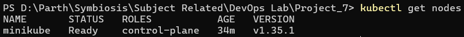

The Minikube components were running, so the cluster was ready for
deployment.

## Step 2: Create the MongoDB Secret

The Kubernetes Secret stores the username and password used by MongoDB
and Mongo Express.

``` yaml
apiVersion: v1
kind: Secret
metadata:
  name: mongodb-secret
type: Opaque
data:
  mongo-root-username: YWRtaW4=
  mongo-root-password: cGFzc3dvcmQ=
```

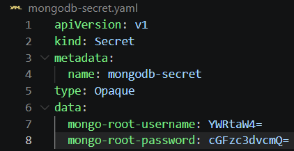

The values in the `data` section are Base64-encoded. Base64 encoding is
not encryption, so this example is suitable for a local practical
demonstration rather than production credential management.

## Step 3: Create the ConfigMap

The ConfigMap stores the name of the MongoDB Service. Mongo Express uses
this value to locate MongoDB inside the cluster.

``` yaml
apiVersion: v1
kind: ConfigMap
metadata:
  name: mongodb-config
data:
  mongo-url: mongodb-service
```

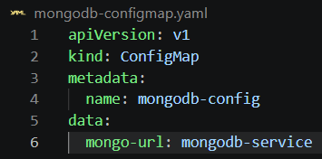

## Step 4: Create the MongoDB Deployment

The MongoDB Deployment manages one MongoDB Pod. The root username and
password are loaded from the Kubernetes Secret through environment
variables.

``` yaml
apiVersion: apps/v1
kind: Deployment
metadata:
  name: mongodb-deployment
spec:
  replicas: 1
  selector:
    matchLabels:
      app: mongodb
  template:
    metadata:
      labels:
        app: mongodb
    spec:
      containers:
        - name: mongodb
          image: mongo:latest
          ports:
            - containerPort: 27017
          env:
            - name: MONGO_INITDB_ROOT_USERNAME
              valueFrom:
                secretKeyRef:
                  name: mongodb-secret
                  key: mongo-root-username
            - name: MONGO_INITDB_ROOT_PASSWORD
              valueFrom:
                secretKeyRef:
                  name: mongodb-secret
                  key: mongo-root-password
```

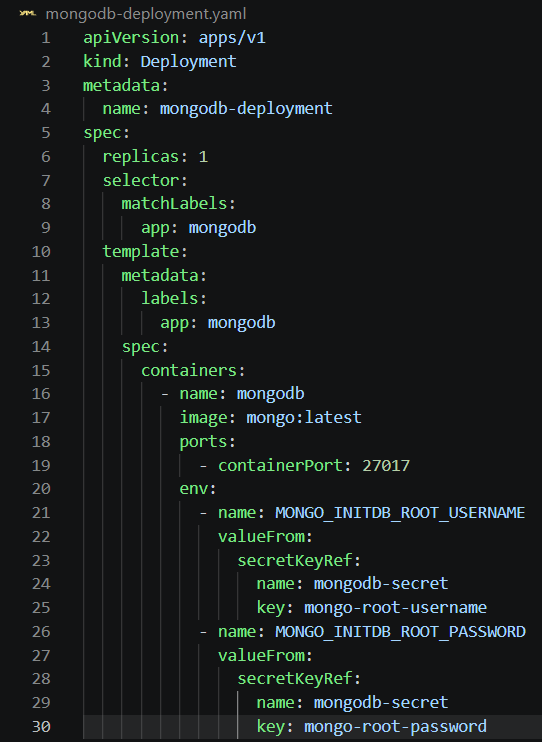

MongoDB listens on container port `27017`.

## Step 5: Create the MongoDB Service

The MongoDB Service provides a stable internal endpoint for other
resources in the cluster.

``` yaml
apiVersion: v1
kind: Service
metadata:
  name: mongodb-service
spec:
  selector:
    app: mongodb
  ports:
    - protocol: TCP
      port: 27017
      targetPort: 27017
```

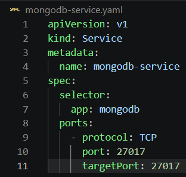

This Service uses the default `ClusterIP` type, so MongoDB is reachable
from inside the Kubernetes cluster.

## Step 6: Create the Mongo Express Deployment

Mongo Express runs in its own Deployment. Its environment variables
obtain the database credentials from the Secret and the MongoDB Service
name from the ConfigMap.

``` yaml
apiVersion: apps/v1
kind: Deployment
metadata:
  name: mongo-express
spec:
  replicas: 1
  selector:
    matchLabels:
      app: mongo-express
  template:
    metadata:
      labels:
        app: mongo-express
    spec:
      containers:
        - name: mongo-express
          image: mongo-express:1.0.0-20
          ports:
            - containerPort: 8081
          env:
            - name: ME_CONFIG_MONGODB_ADMINUSERNAME
              valueFrom:
                secretKeyRef:
                  name: mongodb-secret
                  key: mongo-root-username
            - name: ME_CONFIG_MONGODB_ADMINPASSWORD
              valueFrom:
                secretKeyRef:
                  name: mongodb-secret
                  key: mongo-root-password
            - name: ME_CONFIG_MONGODB_SERVER
              valueFrom:
                configMapKeyRef:
                  name: mongodb-config
                  key: mongo-url
```


Mongo Express uses port `8081` inside its container.

## Step 7: Create the Mongo Express Service

A NodePort Service exposes Mongo Express so that it can be opened from
the host browser.

``` yaml
apiVersion: v1
kind: Service
metadata:
  name: mongo-express-service
spec:
  type: NodePort
  selector:
    app: mongo-express
  ports:
    - protocol: TCP
      port: 8081
      targetPort: 8081
      nodePort: 30000
```


The Service uses port `8081` and NodePort `30000`.

## Step 8: Apply the Kubernetes Resources

The YAML files were applied with `kubectl apply`.

``` powershell
kubectl apply -f mongodb-secret.yaml
```

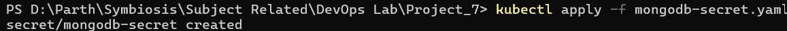

``` powershell
kubectl apply -f mongodb-configmap.yaml
```

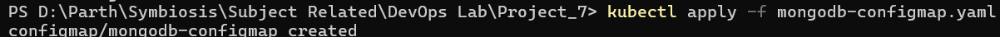

``` powershell
kubectl apply -f mongodb-deployment.yaml
```


``` powershell
kubectl apply -f mongodb-service.yaml
```


``` powershell
kubectl apply -f mongo-express-deployment.yaml
```


``` powershell
kubectl apply -f mongo-express-service.yaml
```


## Step 9: Verify the Kubernetes Resources

The created Secret and ConfigMap were checked first.

``` powershell
kubectl get secrets
```

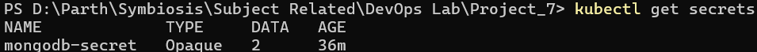

``` powershell
kubectl get configmaps
```


The Deployments and Pods were then checked to confirm that both
applications were ready.

``` powershell
kubectl get deployments
```

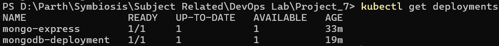

``` powershell
kubectl get pods
```

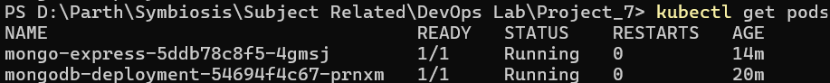

The Services were checked to confirm the MongoDB internal endpoint and
Mongo Express NodePort.

``` powershell
kubectl get svc
```

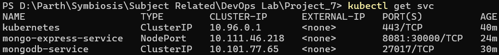

## Step 10: Open Mongo Express

The following command opens the Mongo Express Service through Minikube:

``` powershell
minikube service mongo-express-service
```

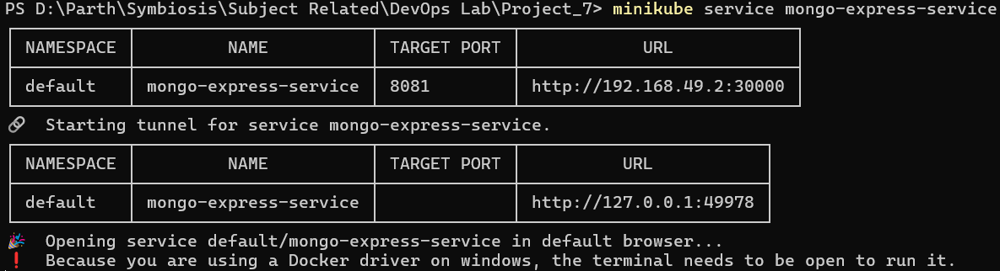

The Mongo Express dashboard loaded in the browser and displayed the
available databases.

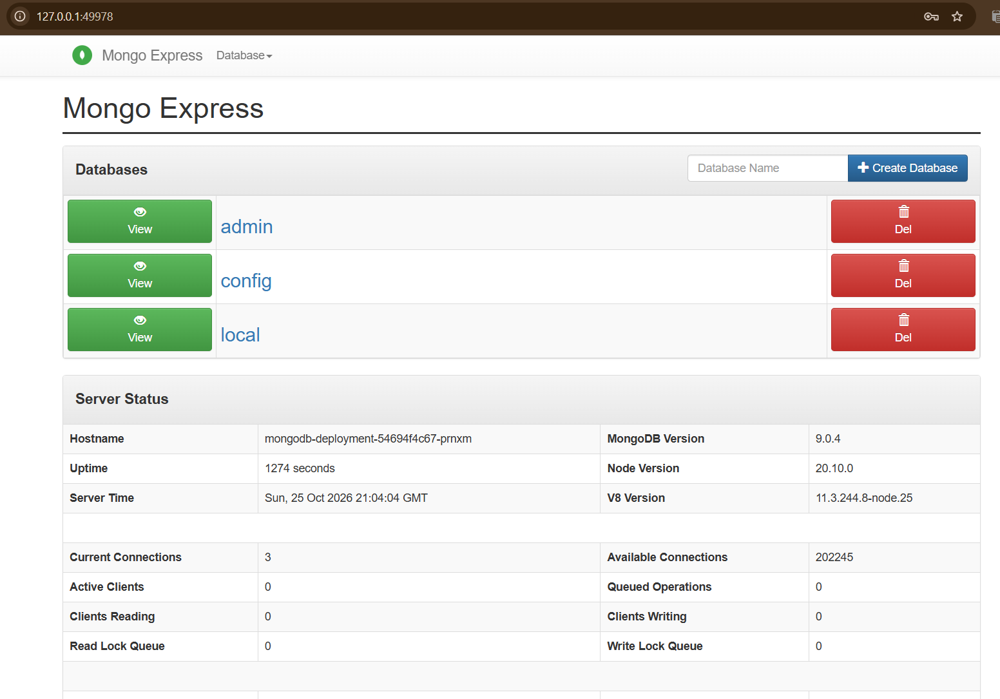

The dashboard confirms that Mongo Express was accessible and could
communicate with MongoDB. The browser's Mongo Express Basic
Authentication credentials shown in the application logs for this local
setup were `admin` and `pass`.

## Step 11: Check Mongo Express Logs

The logs were checked to confirm that Mongo Express started and was
listening on port `8081`.

``` powershell
kubectl logs deployment/mongo-express
```

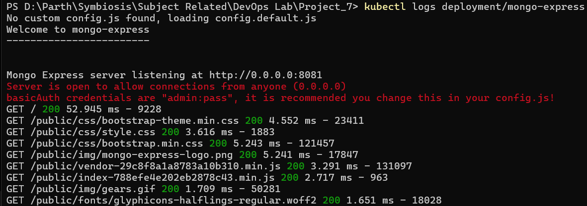

The logs showed the Mongo Express startup message and the server
listening at `http://0.0.0.0:8081`.

## Step 12: Verify the Final Cluster State

The final state of the Kubernetes resources was checked with:

``` powershell
kubectl get all
```


Both the MongoDB and Mongo Express Pods were in the `Running` state and
their Deployments were available.

# Kubernetes Components Used

  Component           Purpose in this project
  ------------------- -------------------------------------------------
  Deployment          Maintains the MongoDB and Mongo Express Pods
  Pod                 Runs each application's container
  Secret              Supplies MongoDB username and password
  ConfigMap           Supplies the MongoDB Service name
  ClusterIP Service   Allows internal communication with MongoDB
  NodePort Service    Makes Mongo Express accessible through Minikube
  `kubectl`           Applies YAML files and verifies resources
  Minikube            Runs the local Kubernetes cluster

# Commands Used

``` powershell
# Check the cluster
minikube status

# Apply the resources
kubectl apply -f mongodb-secret.yaml
kubectl apply -f mongodb-configmap.yaml
kubectl apply -f mongodb-deployment.yaml
kubectl apply -f mongodb-service.yaml
kubectl apply -f mongo-express-deployment.yaml
kubectl apply -f mongo-express-service.yaml

# Verify the resources
kubectl get secrets
kubectl get configmaps
kubectl get deployments
kubectl get pods
kubectl get svc
kubectl get all

# Open Mongo Express and check its logs
minikube service mongo-express-service
kubectl logs deployment/mongo-express
```

# Result

-   Minikube cluster started successfully.
-   MongoDB Secret and ConfigMap were created.
-   MongoDB and Mongo Express Deployments were available.
-   Both application Pods reached the `Running` state.
-   MongoDB was available internally through `mongodb-service`.
-   Mongo Express was exposed through `mongo-express-service` on
    NodePort `30000`.
-   The Mongo Express dashboard opened successfully and displayed the
    databases.
-   Application startup logs and the final cluster state were verified.

**Final Status: SUCCESS**

# Learning Outcomes

-   Creating and applying Kubernetes YAML manifests.
-   Deploying applications using Kubernetes Deployments.
-   Connecting applications using Services.
-   Supplying credentials with Kubernetes Secrets.
-   Supplying application configuration with ConfigMaps.
-   Exposing an application using a NodePort Service.
-   Verifying Pods, Deployments, Services, and application logs.

# Conclusion

MongoDB and Mongo Express were deployed successfully on a local
Kubernetes cluster using Minikube. Kubernetes Secrets and a ConfigMap
supplied the required connection details, while the ClusterIP and
NodePort Services enabled internal database communication and browser
access. The running Pods, application logs, and Mongo Express dashboard
were checked to verify the deployment.
