# Project 8 – Kubernetes Deployment of a Multi-Microservice Application

**Student Name:** Parth Damle\
**PRN:** 23070122161

## Project Description

This project demonstrates deploying a multi-service application setup on Kubernetes using Minikube. It contains Frontend, Product, Customer, and Order Deployments. A ConfigMap stores non-sensitive application settings, while a Secret stores credentials. The Frontend is exposed through a NodePort Service, and the Product, Customer, and Order Services use ClusterIP for internal cluster access.

The Deployments in this implementation use `nginx:latest`. The browser test confirmed that the Frontend Service opened the default NGINX welcome page. The project verifies Kubernetes resource deployment and service exposure; communication between the Product, Customer, and Order services was not separately tested.

## Objective

- Deploy multiple application components on Kubernetes using Deployments and Services.
- Store non-sensitive settings in a ConfigMap.
- Store credentials in a Kubernetes Secret.
- Expose the Frontend using a NodePort Service.
- Create internal ClusterIP Services for Product, Customer, and Order.
- Verify Deployments, Pods, Services, ConfigMap, and Secret.
- Access the Frontend through a browser.

## Technologies Used

| Technology | Purpose |
|---|---|
| Kubernetes | Container orchestration |
| Minikube | Local Kubernetes cluster |
| kubectl | Kubernetes command-line tool |
| Docker | Container runtime used by the local Minikube setup |
| YAML | Kubernetes resource configuration format |
| NGINX | Container image used by the four Deployments |

## Prerequisites

- Docker Desktop
- Minikube
- kubectl
- A running Minikube cluster
- Internet access to pull `nginx:latest` if it is not already available locally

## Project Structure

```text
Project_8/
│
├── app-configmap.yaml
├── app-secret.yaml
│
├── frontend-deployment.yaml
├── frontend-service.yaml
│
├── product-deployment.yaml
├── product-service.yaml
│
├── customer-deployment.yaml
├── customer-service.yaml
│
├── order-deployment.yaml
├── order-service.yaml
│
├── screenshots/
│   ├── 01_configmap_created.png
│   ├── 02_secret_created.png
│   ├── 03_frontend_deployment.png
│   ├── 04_frontend_service.png
│   ├── 05_product_deployment.png
│   ├── 07_product_service.png
│   ├── 08_customer_deployment.png
│   ├── 09_customer_service.png
│   ├── 10_order_deployment.png
│   ├── 11_order_service.png
│   ├── 12_all_deployments_running.png
│   ├── 13_all_services_running.png
│   ├── 14_configmap_verified.png
│   ├── 15_secret_verified.png
│   ├── 16_service_start_command_in_powershell.png
│   ├── 17_frontend_application.png
│   └── 18_final_cluster_state.png
│
└── README.md
```

## Kubernetes Architecture

```text
                         Browser
                            │
                            ▼
                 Frontend Service (NodePort)
                            │
                            ▼
                  Frontend Deployment / Pod

       Product Service       Customer Service       Order Service
              │                     │                    │
              ▼                     ▼                    ▼
       Product Deployment   Customer Deployment   Order Deployment
              │                     │                    │
              ▼                     ▼                    ▼
          Product Pod           Customer Pod           Order Pod

       ConfigMap: app-config       Secret: app-secret
```

The Frontend Service is externally accessed through NodePort `30080`. Product, Customer, and Order use ClusterIP Services. The ConfigMap and Secret are made available to each Deployment as environment variables. The diagram shows the deployed components and does not imply that inter-service API calls were tested.

## Implementation

### Step 1: Create ConfigMap

The ConfigMap stores non-sensitive settings for the application. The actual resource name in the YAML file is `app-config`.

Values in `app-configmap.yaml`:

```yaml
apiVersion: v1
kind: ConfigMap
metadata:
  name: app-config
data:
  APP_NAME: Retail Microservices
  ENVIRONMENT: Kubernetes
  VERSION: v1.0
```

Apply and verify it:

```powershell
kubectl apply -f app-configmap.yaml
kubectl get configmap app-config
```

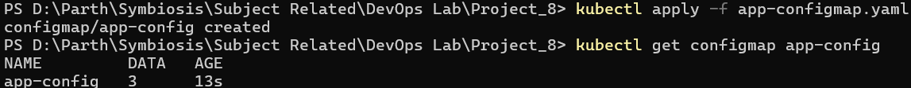

The screenshot shows the ConfigMap apply command and verification output.

### Step 2: Create Secret

The Secret stores the `username` and `password` values. Kubernetes reports it as an `Opaque` Secret with two data entries.

Values in `app-secret.yaml`:

```yaml
apiVersion: v1
kind: Secret
metadata:
  name: app-secret
type: Opaque
stringData:
  username: admin
  password: password123
```

Apply and verify it:

```powershell
kubectl apply -f app-secret.yaml
kubectl get secret app-secret
kubectl describe secret app-secret
```

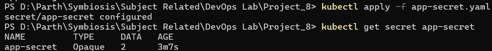

The screenshot confirms that the Secret exists and contains two data entries. Secret values are not shown in the verification screenshot.

### Step 3: Frontend Deployment

The Frontend Deployment runs one replica using `nginx:latest`, exposes container port `80`, and imports values from `app-config` and `app-secret`.

Relevant settings from `frontend-deployment.yaml`:

```yaml
metadata:
  name: frontend-deployment
spec:
  replicas: 1
  template:
    spec:
      containers:
      - name: frontend
        image: nginx:latest
        ports:
        - containerPort: 80
        envFrom:
        - configMapRef:
            name: app-config
        - secretRef:
            name: app-secret
```

Apply and verify it:

```powershell
kubectl apply -f frontend-deployment.yaml
kubectl get deployments
kubectl get pods
```

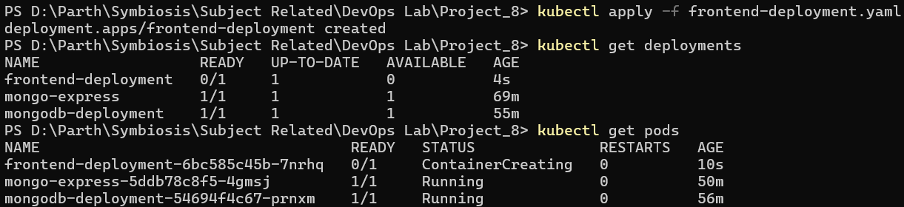

This screenshot records the Deployment creation and an earlier startup state. The later verification screenshots show that the Frontend Deployment and Pod reached `1/1` Ready and `Running`.

### Step 4: Frontend Service

The Frontend Service is a NodePort Service. It maps Service port `80` to target port `80` and NodePort `30080`.

Relevant settings from `frontend-service.yaml`:

```yaml
apiVersion: v1
kind: Service
metadata:
  name: frontend-service
spec:
  selector:
    app: frontend
  type: NodePort
  ports:
    - port: 80
      targetPort: 80
      nodePort: 30080
```

Apply and verify it:

```powershell
kubectl apply -f frontend-service.yaml
kubectl get services
```

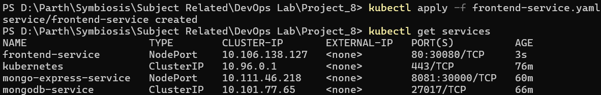

The output confirms that `frontend-service` was created as a NodePort Service using `80:30080/TCP`.

### Step 5: Product Deployment and Service

The Product Deployment runs one `nginx:latest` replica on container port `80` and imports the ConfigMap and Secret as environment variables. Its ClusterIP Service exposes port `80` inside the cluster.

Apply and verify the Deployment:

```powershell
kubectl apply -f product-deployment.yaml
kubectl get deployments
kubectl get pods
```

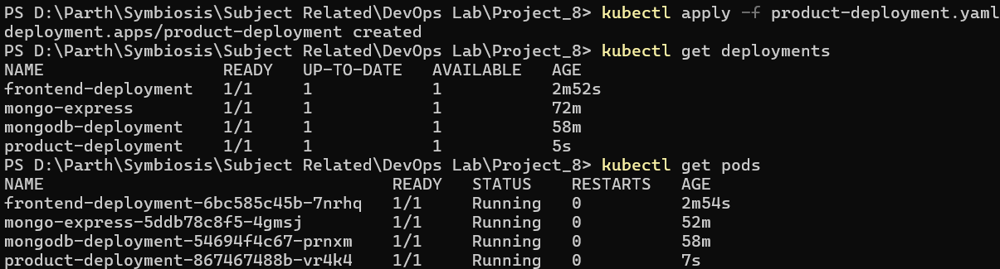

Create and verify the Service:

```powershell
kubectl apply -f product-service.yaml
kubectl get services
```

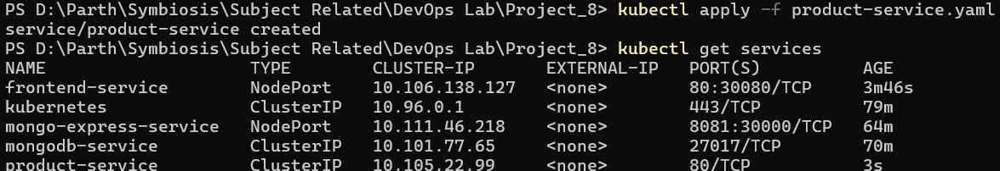

The screenshots show the Product Deployment and Product Service creation and verification.

### Step 6: Customer Deployment and Service

The Customer Deployment runs one `nginx:latest` replica on container port `80` and imports the ConfigMap and Secret as environment variables. Its ClusterIP Service exposes port `80` inside the cluster.

Apply and verify the Deployment:

```powershell
kubectl apply -f customer-deployment.yaml
kubectl get deployments
kubectl get pods
```

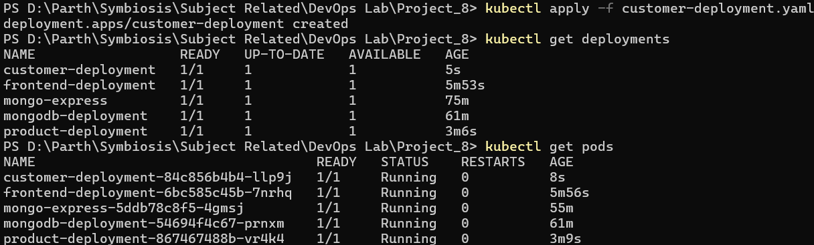

Create and verify the Service:

```powershell
kubectl apply -f customer-service.yaml
kubectl get services
```

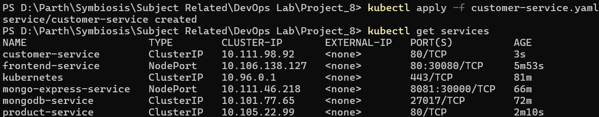

### Step 7: Order Deployment and Service

The Order Deployment runs one `nginx:latest` replica on container port `80` and imports the ConfigMap and Secret as environment variables. Its ClusterIP Service exposes port `80` inside the cluster.

Apply and verify the Deployment:

```powershell
kubectl apply -f order-deployment.yaml
kubectl get deployments
kubectl get pods
```

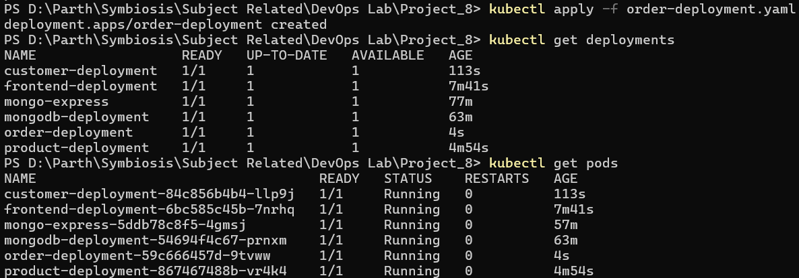

Create and verify the Service:

```powershell
kubectl apply -f order-service.yaml
kubectl get services
```

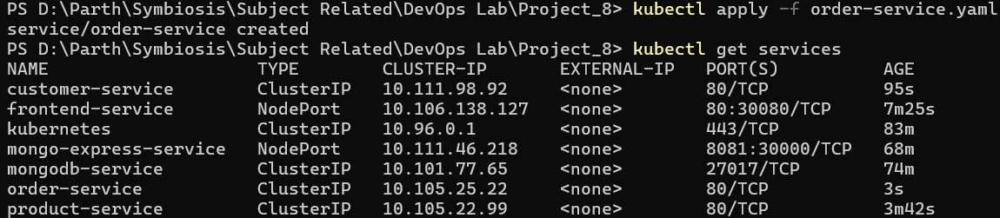

### Step 8: Verify Kubernetes Resources

The resources were checked using `kubectl` to confirm that the four application Deployments and their Pods were running and that the Services, ConfigMap, and Secret existed.

```powershell
kubectl get deployments
kubectl get pods
kubectl get services
kubectl get configmap app-config
kubectl get secret app-secret
kubectl get all
```

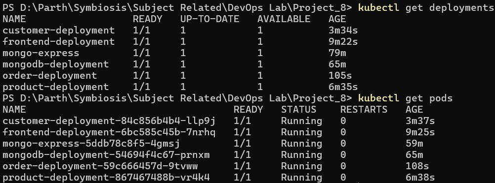

The four application Deployments show `1/1` Ready, and their Pods show `Running` with zero restarts in the captured output.

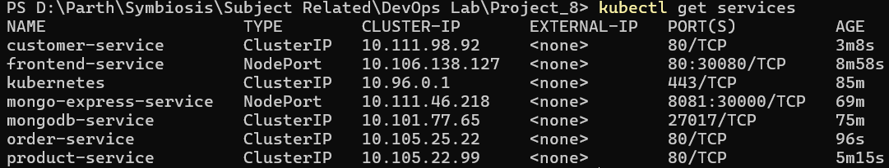

The output shows the Frontend NodePort Service and the Product, Customer, and Order ClusterIP Services.

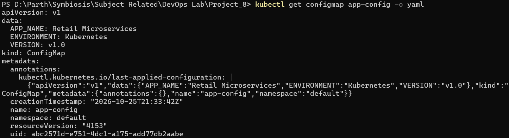

The ConfigMap verification shows the stored values `APP_NAME`, `ENVIRONMENT`, and `VERSION`.

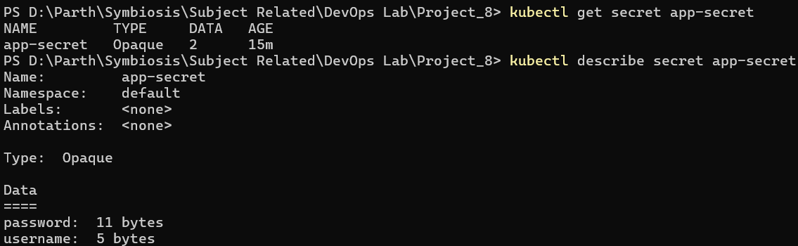

The Secret verification shows the `Opaque` type and two data entries.

### Step 9: Access the Frontend

The Frontend Service was opened using Minikube's service command:

```powershell
minikube service frontend-service
```

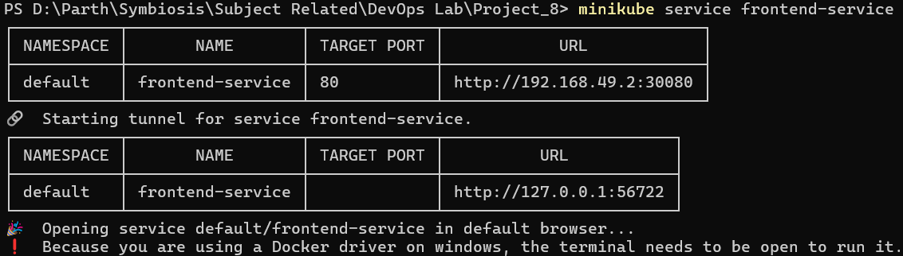

This screenshot records the PowerShell command used to open the Service.

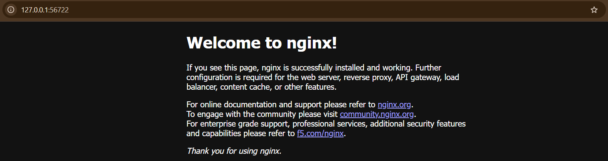

The browser displayed the default **Welcome to nginx!** page. This confirms that the NGINX frontend container was accessible through the Service. It is the default NGINX page, not a custom retail UI.

### Step 10: Final Cluster State

The final resource listing was captured with:

```powershell
kubectl get all
```

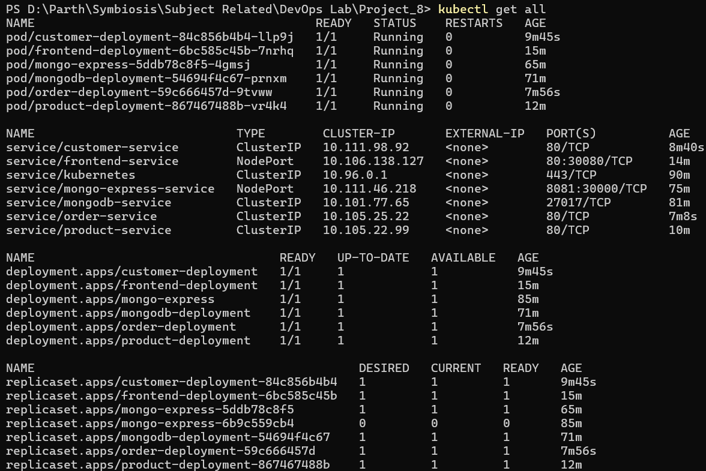

The final screenshot shows the application resources alongside the existing MongoDB and Mongo Express resources from the previous project. Those resources were still present in the shared Minikube cluster during this verification.

## Kubernetes Workflow

```text
ConfigMap ─┐
           ├──> Deployments ──> Pods
Secret ────┘                       │
                                   ▼
                       Kubernetes Services
                        │              │
                        ▼              ▼
                  Frontend          Product / Customer / Order
                   NodePort             ClusterIP
                        │
                        ▼
                      Browser
```

## Kubernetes Components Used

| Component | Purpose in this project |
|---|---|
| Deployment | Maintains the desired state of each application Pod |
| Pod | Runs a container for each deployed component |
| ReplicaSet | Maintains the requested number of Pod replicas for a Deployment |
| Service | Provides a stable network endpoint for selected Pods |
| NodePort | Exposes the Frontend Service through a node port |
| ClusterIP | Provides internal cluster access to Product, Customer, and Order |
| ConfigMap | Provides non-sensitive settings as environment variables |
| Secret | Provides credentials as environment variables |

## Commands Used

### Apply Resources

```powershell
kubectl apply -f app-configmap.yaml
kubectl apply -f app-secret.yaml
kubectl apply -f frontend-deployment.yaml
kubectl apply -f frontend-service.yaml
kubectl apply -f product-deployment.yaml
kubectl apply -f product-service.yaml
kubectl apply -f customer-deployment.yaml
kubectl apply -f customer-service.yaml
kubectl apply -f order-deployment.yaml
kubectl apply -f order-service.yaml
```

### Verify Resources

```powershell
kubectl get deployments
kubectl get pods
kubectl get services
kubectl get configmap app-config
kubectl get secret app-secret
kubectl get all
```

### Open Frontend

```powershell
minikube service frontend-service
```

## Build Result

- ConfigMap `app-config` created and verified.
- Secret `app-secret` created and verified.
- Frontend, Product, Customer, and Order Deployments reached `1/1` Ready.
- All four application Pods were shown as `Running` with zero restarts in the captured verification output.
- Frontend NodePort Service was created on NodePort `30080`.
- Product, Customer, and Order ClusterIP Services were created.
- Frontend was accessed in a browser and displayed the default NGINX welcome page.

## Learning Outcomes

- Creating and applying Kubernetes YAML manifests.
- Deploying workloads using Deployments and Pods.
- Exposing applications using NodePort and ClusterIP Services.
- Providing configuration through ConfigMaps.
- Providing credentials through Secrets.
- Verifying Kubernetes resources using `kubectl`.
- Accessing a Service through Minikube.

## Conclusion

This project demonstrated how to deploy four application components—Frontend, Product, Customer, and Order—on a local Kubernetes cluster. A ConfigMap and Secret were used to provide configuration and credentials to the Deployments. The Frontend was exposed through a NodePort Service, while the other three Services used ClusterIP. The captured verification outputs showed all four application Deployments ready and their Pods running, and the Frontend was successfully opened in a browser displaying the default NGINX welcome page.
