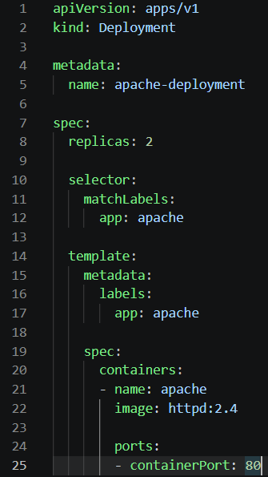
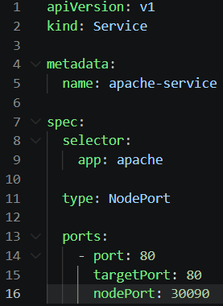
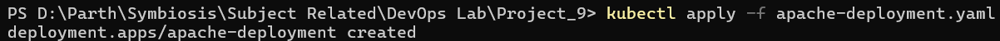
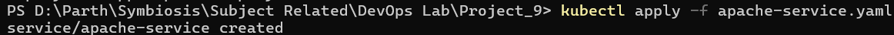
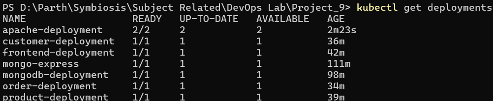
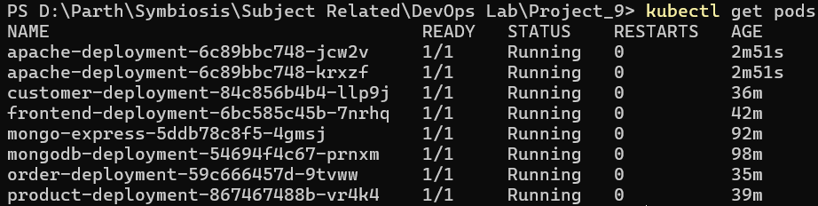
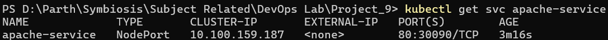
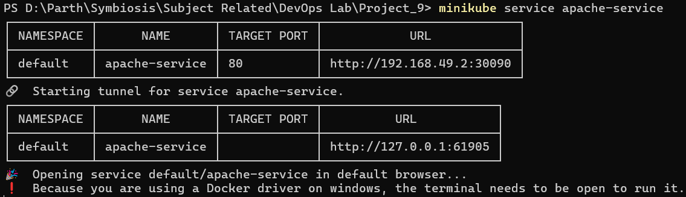
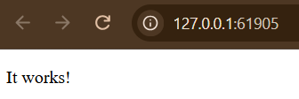
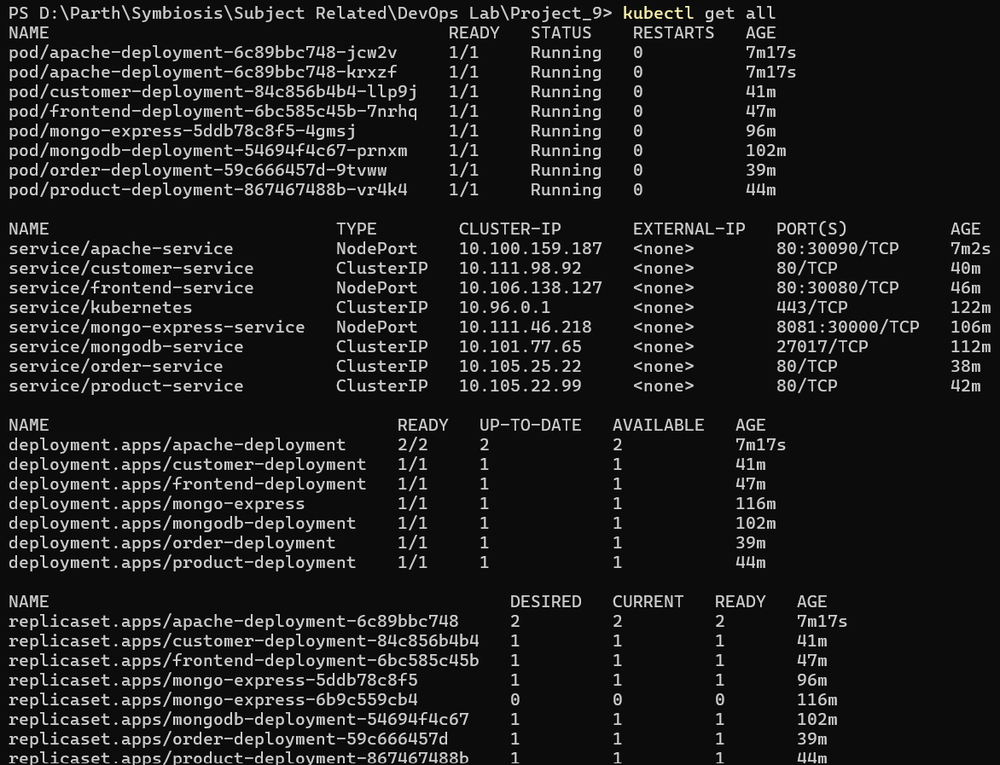

# Project 9: Apache Web Server Deployment on Kubernetes

**Student Name:** Parth Damle\
**PRN:** 23070122161

## 1. Project Overview

This project demonstrates how to deploy an Apache HTTP Server on Kubernetes using Minikube. A Kubernetes Deployment runs two Apache replicas, while a NodePort Service exposes the application so it can be accessed through a web browser.

## 2. Objectives

- Deploy Apache HTTP Server using a Kubernetes Deployment.
- Run multiple replicas of the Apache web server.
- Expose Apache using a NodePort Service.
- Verify that the Deployment, Pods, and Service are running.
- Access the Apache web page through a browser.
- Understand how Kubernetes Deployments and Services work together.

## 3. Technologies Used

- **Kubernetes** — container orchestration.
- **Minikube** — runs a local Kubernetes cluster.
- **kubectl** — manages Kubernetes resources.
- **Docker** — runtime environment used by Minikube.
- **Apache HTTP Server** — the web server deployed in this project.
- **YAML** — defines Kubernetes resources.

## 4. Project Structure

```text
Project_9/
├── apache-deployment.yaml
├── apache-service.yaml
├── screenshots/
│   ├── 01_apache_deployment_yaml.png
│   ├── 02_apache_service_yaml.png
│   ├── 03_deployment_apply_success.png
│   ├── 04_service_apply_success.png
│   ├── 05_deployments_running.png
│   ├── 06_pods_running.png
│   ├── 07_service_running.png
│   ├── 08_start_service_cmd_in_powershell.png
│   ├── 09_apache_homepage_browser.png
│   └── 10_final_cluster_state.png
├── README.md
└── .gitignore
```

## 5. Architecture

```text
              Web Browser
                   |
                   v
          Apache NodePort Service
              NodePort: 30090
                   |
                   v
          Apache Deployment
             (2 Replicas)
              /        \
             v          v
        Apache Pod   Apache Pod
          Port 80      Port 80
```

The Deployment maintains two Apache Pods. The Service selects the Pods using the label `app: apache` and routes traffic to them.

## 6. Implementation

### Step 1: Create the Apache Deployment

The `apache-deployment.yaml` file defines the Kubernetes Deployment.

- **Deployment name:** `apache-deployment`
- **Replicas:** 2
- **Container image:** `httpd:2.4`
- **Container port:** 80

The Deployment ensures that two Apache Pods are running in the cluster.



### Step 2: Create the Apache Service

The `apache-service.yaml` file defines a NodePort Service.

- **Service name:** `apache-service`
- **Service type:** NodePort
- **Service port:** 80
- **Target port:** 80
- **NodePort:** 30090

The Service exposes the Apache application through a port on the Kubernetes node.



### Step 3: Apply the Deployment

Run the following command to create the Apache Deployment:

```powershell
kubectl apply -f apache-deployment.yaml
```

Kubernetes confirmed that the Deployment was created successfully.



### Step 4: Apply the Service

Run the following command to create the Apache Service:

```powershell
kubectl apply -f apache-service.yaml
```

Kubernetes confirmed that the Service was created successfully.



### Step 5: Verify the Deployment

Run:

```powershell
kubectl get deployments
```

The Apache Deployment showed two desired replicas and two available replicas, confirming that both replicas were ready. Resources from the earlier projects were also present in the same Minikube cluster.



### Step 6: Verify the Apache Pods

Run:

```powershell
kubectl get pods
```

Both Apache Pods reached the `Running` state. Each Apache Pod showed `1/1` containers ready and zero restarts.



### Step 7: Verify the Apache Service

Run:

```powershell
kubectl get svc apache-service
```

The Service was available as a `NodePort` Service with the port mapping `80:30090/TCP`.



### Step 8: Access the Apache Web Server

Run:

```powershell
minikube service apache-service
```

Minikube opened the Service through a locally forwarded address so it could be accessed in the browser.



### Step 9: Verify the Apache Web Page

The Apache web page opened successfully in the browser and displayed **“It works!”** This confirmed that the web server was accessible through the Kubernetes Service.



### Step 10: Verify the Final Cluster State

Run:

```powershell
kubectl get all
```

The output showed the Apache Deployment, its Pods, and the Apache Service. It also showed resources belonging to the previously completed Projects 7 and 8, which were left running in the shared Minikube cluster.



## 7. Results

The Apache Web Server Deployment was completed successfully.

- The Apache Deployment was created successfully.
- Both Apache replicas were ready.
- Both Apache Pods were running with zero restarts.
- The NodePort Service was available on port `30090`.
- The Apache web page opened successfully in the browser and displayed “It works!”.

## 8. Conclusion

This project demonstrated how to deploy an Apache HTTP Server on Kubernetes using Minikube. A Deployment maintained two Apache replicas, and a NodePort Service exposed the application for browser access. The successful browser test confirmed that the web server was accessible through the Kubernetes Service.
